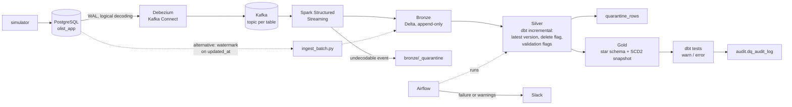
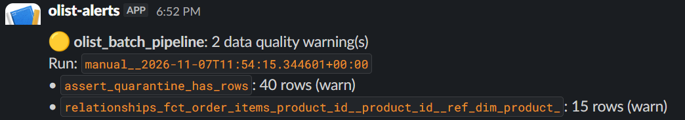
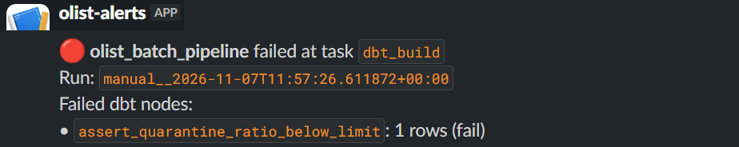
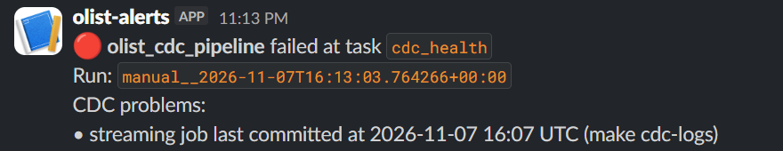
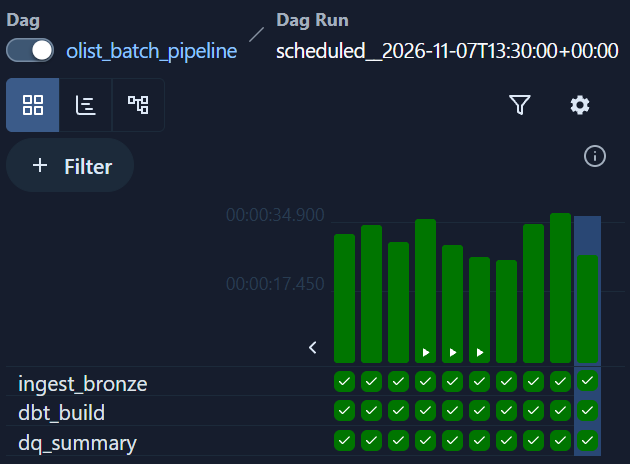
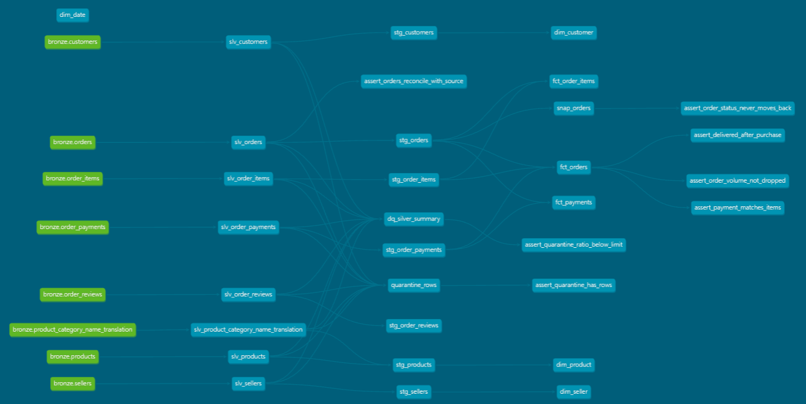

# Olist CDC Lakehouse

[](https://github.com/alfinosp/olist-cdc-lakehouse/actions/workflows/ci.yml)
[](LICENSE)

**Problem.** Analytics teams often copy application databases with nightly or 15-minute batch jobs. Reports then keep counting records that were deleted, lose how an order moved between statuses, run on numbers that are minutes old, and break quietly when the source sends bad data.

**What this project does**, on the [Olist Brazilian E-Commerce dataset](https://www.kaggle.com/datasets/olistbr/brazilian-ecommerce), running on a laptop with Docker:

- **Capture:** every insert, update and delete in a live Postgres database is streamed by Debezium, Kafka and Spark Structured Streaming into an append-only Delta Bronze layer. A watermark batch path writes the same Bronze contract.
- **Model:** dbt turns Bronze into Silver (latest version per key) and a Gold star schema with SCD2 order history. The dbt project is identical for either ingestion path.
- **Check:** dbt tests quarantine bad rows, warn on anomalies and stop the run when a table goes bad.
- **Operate:** Airflow runs it every 15 minutes, checks the streaming path, and posts failures and warnings to Slack.

**Outcome** (measured, see [Measured on a laptop](#measured-on-a-laptop))

| Before (batch copy) | After (this pipeline) |
|---|---|
| A review deleted by the customer still counts in ratings and reports | Deleted rows disappear from reports on the next refresh |
| Changes reach the analytics store up to 15 minutes late | Changes land in 4 seconds; reports refresh every 15 minutes today, and that is a schedule setting, not a redesign |
| An order that went *processing → shipped* inside one window shows only its last status | The full history of every order is kept and queryable |
| Bad source data either breaks the dashboard or slips into it unnoticed | Bad rows are held back and reported; the run fails and alerts when more than 1% of a table is bad |
| A broken pipeline is noticed when someone complains about stale numbers | Slack says what broke and why within one run |
| A crash or restart risks double-counted orders | Restarted under load: 0 duplicates |

How each of these is done: [Engineering problems solved](#engineering-problems-solved).

## Tech stack


-231F20?style=for-the-badge&logo=apachekafka&logoColor=white)


## Architecture



| Layer | Tool | Notes |
|-------|------|-------|
| Source | PostgreSQL 16 | 8 Olist tables + `created_at` / `updated_at` / `deleted_at`, `wal_level=logical` |
| CDC | Debezium 2.7 (pgoutput) on Kafka Connect | One topic per table, initial snapshot, heartbeat keeps the slot moving |
| Broker | Apache Kafka 3.8, KRaft, one broker | No ZooKeeper |
| Streaming | Spark Structured Streaming 3.5 | Kafka offsets and checkpoint in Spark; micro-batches decoded into Bronze |
| Batch (alternative) | Python, psycopg, polars | Watermark on `updated_at`; useful without the CDC stack |
| Bronze | Delta Lake (delta-rs) | Append-only, source columns as text, `_op` / `_source_ts` / `_lsn` metadata |
| Silver | dbt + DuckDB | One row per key, newest `_source_ts` (then `_lsn`) wins, `_is_deleted`, `_dq_errors` |
| Gold | dbt + DuckDB | `fct_orders`, `fct_order_items`, `fct_payments`, `dim_*`, `snap_orders` (SCD2) |
| Data quality | dbt tests | Generic, custom generic and singular tests; quarantine; audit log |
| Orchestration | Airflow 3 (LocalExecutor) | 15-minute schedule, CDC health check, Slack alerts |
| CI | GitHub Actions | Ruff, pytest, `dbt build` on fixture Bronze built through both paths |

## How CDC reaches Bronze

1. Debezium reads the Postgres WAL through the `olist_debezium` replication slot and publishes one JSON event per row change to `olist.olist_app.<table>`. Tables use `REPLICA IDENTITY FULL`, so a delete carries the whole row.
2. Spark subscribes to those topics (plus Debezium's 10-second heartbeat table, so a micro-batch commits even when the source is idle) and, every 30 seconds, hands the micro-batch to `olist.cdc.write_events`.
3. Each value is rendered as the text Postgres would print for it, so a row captured by CDC is identical to the same row read by the batch path. Metadata: `_op` (`r` snapshot, `c`, `u`, `d`), `_source_ts` (commit time), `_lsn`.
4. An event that does not fit the contract goes to `bronze/_quarantine` with the error and its Kafka offset. The stream keeps running, and the `cdc_health` task in Airflow fails and alerts.

Delivery is at-least-once: a crash between the Bronze write and the offset commit replays that micro-batch. The replayed rows have the same `_source_ts` and `_lsn`, and Silver keeps one row per key, so Silver and Gold have no duplicates. CI proves the "same contract" claim: it builds Bronze from the same fixture rows through the batch writer and through Debezium-encoded events, and runs the unchanged dbt project on both.

## Engineering problems solved

| Problem | Approach |
|---------|----------|
| CDC and batch rows must be identical, or every dbt model needs two branches | Debezium values are rendered as Postgres text (`MicroTimestamp` -> `2018-03-01 10:00:00`); CI builds Bronze both ways from the same fixtures and runs one dbt project on both |
| Streaming is at-least-once: a restart can replay a micro-batch | Bronze stays append-only; Silver keeps one row per key by `_source_ts`, then `_lsn`, so replays never reach Gold |
| A replication slot left behind can fill the source disk | `max_slot_wal_keep_size=2GB`, a 10-second heartbeat so the slot advances when tables are idle, and `make cdc-reset` |
| A stream can die silently | `cdc_health` checks the connector state, the last Spark checkpoint commit and newly quarantined events; the alert names the cause |
| Bad source rows must not reach dashboards, but must not stop the pipeline either | Rows are flagged in Silver and quarantined; a warning when any exist, a failing test above 1% of a table |
| Alerts that always fire get ignored | Warning thresholds calibrated on the real baseline (249 known payment mismatches -> warn above 275) |

## Measured on a laptop

WSL2 with 9 GB assigned, full CDC stack plus the simulator at 30 events per minute.

| What | Result |
|------|--------|
| Postgres commit to Bronze (CDC) | 4 s for an update, 24 s for a hard delete; bounded by the 30-second trigger |
| Postgres commit to Bronze (batch) | up to the 15-minute schedule; changes between two runs collapse into the last state |
| Bronze to Silver and Gold | next DAG run, every 15 minutes; one run takes 25 to 50 s |
| Initial snapshot, about 557,000 events | Debezium 2 min, Spark 13 min (20,000 events per trigger) |
| Spark restarted under load | resumed from its checkpoint, 0 duplicate events in Bronze, Gold `unique` tests pass |
| Spark stopped for 8 minutes | `cdc_health` alert after 5 minutes; on restart the backlog (688 events) landed in one micro-batch |
| Hard delete in Postgres | Bronze `_op = 'd'`, Silver `_is_deleted = true`, row gone from Gold; the batch path never sees it |
| Memory, steady state | about 4.5 GB: Airflow 2.4, Spark 0.7 (1.2 during the snapshot), Kafka Connect 0.6, Kafka 0.6, Postgres 0.2 |

## What the Gold layer answers

On the original Olist orders (2016 to 2018), straight from `gold.fct_orders`, `gold.fct_order_items` and `gold.dim_product`:

| Question | Answer |
|----------|--------|
| How many delivered orders arrive after the promised date? | 8.1% of 96,470; median delivery time 10 days |
| Busiest month? | November 2017, 7,544 orders (Black Friday) |
| Top categories by item revenue? | health_beauty (BRL 1.26 M), watches_gifts (1.21 M), bed_bath_table (1.04 M) |

```sql
select round(100.0 * avg(is_late::int), 1) as late_pct, median(delivery_days) as median_days
from gold.fct_orders
where order_status = 'delivered' and order_delivered_customer_date < '2019-01-01';
```

## Screenshots

| Data quality warning | Pipeline stopped by an error-level test |
|---|---|
|  |  |

CDC health check failing, with the reason in the alert:



Airflow, one bar per 15-minute run (ingest or health check, dbt build, data quality summary):



dbt lineage, Bronze sources (green) to Silver, quarantine, staging, Gold and tests:



## Data quality

dbt checks the data, Airflow reports it.

| Check | Where | Severity |
|-------|-------|----------|
| Undecodable CDC event | `bronze/_quarantine` -> `cdc_health` task | error (alert) |
| Debezium connector or task not running | `cdc_health` task | error (alert) |
| Streaming job stalled (no checkpoint commit in 5 min; heartbeats keep it moving when idle) | `cdc_health` task | error (alert) |
| Unparseable values, invalid status, negative amounts, out-of-range scores | Silver `_dq_errors` -> `quarantine_rows` | row excluded from Gold |
| Any quarantined row | `assert_quarantine_has_rows` | warn |
| More than 1% of a table quarantined | `assert_quarantine_ratio_below_limit` | error |
| Silver vs Postgres active orders, at the point Silver has caught up to | `assert_orders_reconcile_with_source` | error |
| Primary keys, accepted values, non-negative amounts | Gold schema tests | error |
| Foreign keys, future timestamps, order volume drop, status moving backwards | Gold tests | warn |

Every test result is appended to `audit.dq_audit_log` by an `on-run-end` hook. Failed rows are stored in the `dq_failures` schema.

## Limitations and next steps

Built to run on one laptop. What I would change for production, and why it is not done here:

| Limitation | In production |
|------------|---------------|
| Silver and Gold refresh every 15 minutes, so reports lag Bronze | Run dbt more often, or serve the few metrics that need seconds straight from the stream |
| Spark hands each micro-batch to a Python writer on the driver ([ADR 0004](docs/adr/0004-cdc-bronze-writer.md)) | Decode with Spark SQL and write with Spark's Delta writer, idempotent via `txnAppId` / `txnVersion` |
| One Kafka broker, replication factor 1, JSON events ([ADR 0003](docs/adr/0003-kafka-kraft-single-broker.md)) | Three brokers, replication factor 3, Avro with a schema registry |
| DuckDB allows a single writer, so Airflow and ad-hoc queries take turns | A shared warehouse (BigQuery, Snowflake) with the same dbt project and a different adapter |
| Switching from batch to CDC adds one SCD2 version per order with unchanged values, because the snapshot uses a timestamp strategy | Snapshot with the `check` strategy on business columns |
| Credentials are local defaults and Airflow has no login | Secrets from a secret manager, Airflow behind real authentication |
| Failure scenarios were run by hand (results above) | Automate them as an integration test against the Compose stack |

## Run it yourself

### Prerequisites

| Need | Notes |
|------|-------|
| Linux, macOS, or Windows with WSL2 | On Windows, clone inside WSL (`~/...`), not under `/mnt/c`: Docker reads the Linux filesystem much faster |
| Docker with Compose v2 | About 8 GB of memory for the full CDC stack (container limits; measured use is about 5 GB). The batch path alone needs about 3 GB |
| Python 3.11+, `make`, `git` | The project virtualenv is created by `make venv` |
| Kaggle API token | Kaggle → Settings → API → *Create New Token*, saved as `~/.kaggle/kaggle.json` (or `KAGGLE_API_TOKEN`). Used once to download the dataset |
| DuckDB CLI (optional) | To browse the warehouse in step 4; install from [duckdb.org](https://duckdb.org/docs/installation/) the same version as the Python package (`.venv/bin/python -c "import duckdb; print(duckdb.__version__)"`), since an older CLI may not open a newer file |
| Slack Incoming Webhook (optional) | Without it, alerts are written to the Airflow task log only |
| Free ports on 127.0.0.1 | 5432 Postgres, 8080 Airflow, 8081 dbt docs, 8083 Kafka Connect, 29092 Kafka |

### 1. Clone and configure

```bash
git clone https://github.com/alfinosp/olist-cdc-lakehouse.git
cd olist-cdc-lakehouse
cp .env.example .env
sed -i.bak "s/^AIRFLOW_UID=.*/AIRFLOW_UID=$(id -u)/" .env && rm .env.bak   # containers write ./data as your user
# optional: paste your webhook after SLACK_WEBHOOK_URL= in .env
make venv                                              # .venv with the project, dbt, pytest, ruff
```

### 2. Load the source database

```bash
make up          # Postgres 16 with wal_level=logical, schema created on first start
make download    # Olist CSV files from Kaggle into data/raw (about 45 MB)
make seed        # about 550,000 rows into olist_app.*
```

### 3a. Run with change data capture (full stack)

```bash
make cdc-up      # Kafka, Debezium, Spark, Airflow in CDC mode; registers the connector
make cdc-status  # connector and task RUNNING, one topic per table
make cdc-logs    # wait until "batch N: ... records" drops to a few records (initial snapshot, ~15 min); Ctrl+C to leave
make sim-up      # continuous inserts, updates and deletes (SIM_BAD_RATE=0.02 make sim-up adds bad rows)
```

Open http://localhost:8080, enable `olist_cdc_pipeline` and trigger it (it also runs every 15 minutes).

### 3b. Run with batch ingestion only (lighter, no Kafka)

```bash
make ingest dbt-deps dbt-build   # one pass: Postgres -> Bronze -> Silver -> Gold, with tests
```

Or orchestrated: `make airflow-up`, open http://localhost:8080, enable `olist_batch_pipeline`, then `make sim-up`.

### 4. Look at the results

```bash
duckdb -readonly data/warehouse/olist.duckdb   # DuckDB CLI; stop Airflow first if a run is writing
```

```sql
select order_status, count(*) from gold.fct_orders group by 1 order by 2 desc;
select * from quarantine.quarantine_rows limit 10;
select run_at, status, count(*) from audit.dq_audit_log group by all order by run_at desc limit 10;
```

`make dbt-docs` serves the dbt documentation and lineage graph on http://localhost:8081.

### 5. Try the failure scenarios (CDC mode)

```bash
# An update reaches Bronze in seconds, Silver and the SCD2 snapshot on the next DAG run
docker compose exec postgres psql -U olist -d olist -c \
  "update olist_app.orders set order_status = 'canceled' where order_id = (select order_id from olist_app.orders where order_status = 'shipped' limit 1) returning order_id"

# A hard delete: Silver flags _is_deleted, the batch path would never see it
docker compose exec postgres psql -U olist -d olist -c \
  "delete from olist_app.order_reviews where review_id = (select review_id from olist_app.order_reviews limit 1) returning review_id"

# An undecodable event: lands in bronze/_quarantine, the stream keeps running, cdc_health alerts
docker compose -f docker-compose.yml -f docker-compose.cdc.yml exec kafka bash -c \
  "echo '{broken' | /opt/kafka/bin/kafka-console-producer.sh --bootstrap-server localhost:9092 --topic olist.olist_app.orders"

# A stalled stream: stop Spark for more than 5 minutes, trigger the DAG, then make cdc-up
docker compose -f docker-compose.yml -f docker-compose.cdc.yml stop spark
```

### 6. Stop and clean up

```bash
make down        # stop everything; data, Kafka topics and the replication slot are kept
make cdc-reset   # drop connector, replication slot, topics and Spark checkpoint (next cdc-up re-snapshots)
make reset       # DELETE everything: Postgres volume, Kafka, data/lake, data/warehouse
```

A replication slot keeps WAL until Debezium confirms it. `max_slot_wal_keep_size=2GB` caps that, so a CDC stack left stopped cannot fill the disk; if the cap is hit the slot is invalidated and `make cdc-reset && make cdc-up` takes a fresh snapshot (Silver absorbs the repeated rows). `make cdc-register` re-applies the connector config at any time.

### Development

```bash
.venv/bin/pre-commit install   # once: whitespace, YAML, private keys and ruff on every commit
make test lint                 # unit tests and ruff
make ci-local                  # what CI runs: tests, then dbt build on fixture Bronze via batch and via CDC
make help                      # every make target
```

If the Spark image build fails with `unresolved dependency ... spark-sql-kafka`, Maven Central is refusing your network (HTTP 403); the build already falls back to Google's mirror of Central, so check that `https://maven-central.storage-download.googleapis.com/maven2/` is reachable.

## Design decisions

- [ADR 0001: Silver, Gold and data quality in dbt](docs/adr/0001-silver-and-dq-in-dbt.md)
- [ADR 0002: Watermark batch ingestion as the fallback path](docs/adr/0002-watermark-batch-before-cdc.md)
- [ADR 0003: Kafka in KRaft mode with a single broker](docs/adr/0003-kafka-kraft-single-broker.md)
- [ADR 0004: Spark owns offsets, a shared writer owns Bronze](docs/adr/0004-cdc-bronze-writer.md)

## Data and license

Code is released under the [MIT License](LICENSE). The dataset is published by Olist on Kaggle under CC BY-NC-SA 4.0. It is not stored in this repository; `make download` fetches it.
